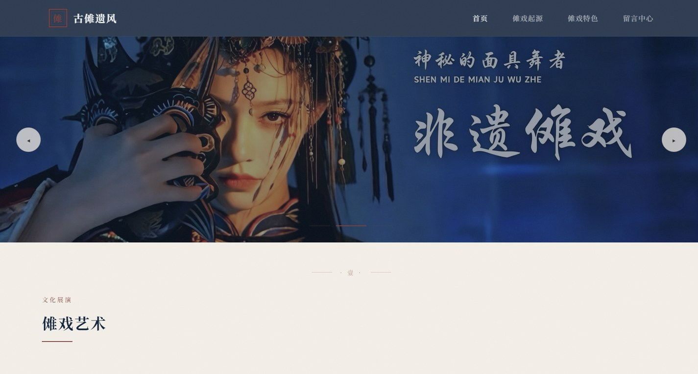

# 非遗傩戏 · 千年祭祀文化艺术

> 面具之下，是人与天地的对话。

**以新中式视觉语言构建的傩文化数字展陈网站**  
毕业设计作品 · 使用 Claude Code 辅助开发

[](https://developer.mozilla.org/zh-CN/docs/Web/HTML)
[](https://developer.mozilla.org/zh-CN/docs/Web/CSS)
[](https://developer.mozilla.org/zh-CN/docs/Web/JavaScript)
[](https://claude.com/claude-code)
[](#项目简介)

**[在线预览](https://morningluu.github.io/nuoxi-opera-website/)** · **[源码仓库](https://github.com/morningluu/nuoxi-opera-website)**



---

## 项目简介

傩戏是中国最古老的祭祀性戏剧形态之一，发端于商周驱疫仪式，至今仍在贵州、江西、湖南、安徽等地活态流传。本项目以“**古傩遗风**”为题，把傩戏的起源、面具、剧目、服饰、乐器和传承现状组织成一套可浏览的数字展陈。

设计没有采用常见的“非遗红 + 传统纹样堆叠”，而是以**宣纸米色**为底、**靛蓝**为骨、**朱砂红**为魂，配以毛笔标题字、大面积留白和缓慢的滚动叙事，让页面更接近一册可交互的文化研究读物。

## 页面与功能

| 页面 | 文件 | 主要内容 |
| --- | --- | --- |
| 首页 | `index.html` | 全屏傩戏主视觉轮播、傩戏艺术概述、热门表演、面具 / 服饰 / 演出 / 乐器四大板块、文化亮点 |
| 傩戏起源 | `origin.html` | 从商周驱疫到六朝、唐宋、明清的时间线，地域流派与活态传承 |
| 傩戏特色 | `feature.html` | 面具艺术、角色谱系、经典剧目轮播、工艺与表演体系 |
| 留言中心 | `contact.html` | 研究咨询 / 合作留言表单、图形验证码、字段校验、成功反馈 |

### 核心交互

- **主视觉轮播**：支持自动播放、前后切换、指示点、鼠标悬停暂停、触屏滑动与键盘方向键。
- **滚动叙事**：使用 `IntersectionObserver` 让标题、卡片和数字在进入视口时依次显现。
- **时间线**：起源页以纵向节点呈现六个历史阶段，点击节点可展开对应说明。
- **影像胶片带**：以循环滚动的 film strip 承载剧目与面具图像，强化“档案 / 展陈”的氛围。
- **数字计数**：文化数据在滚动到对应区域时执行 count-up 动画。
- **表单验证**：留言页校验必填字段、邮箱格式与四位图形验证码；验证码可点击刷新，提交后显示成功状态。
- **页面转场**：进入页面时的淡入与标题上浮，形成统一的仪式感。
- **响应式**：7 组媒体查询适配桌面、平板和手机，移动端使用抽屉式导航。

## 设计说明

- **色彩**：`#F5F0E8` 宣纸底色、`#1A3C5E` 靛蓝、`#8B3A3A` 朱砂、`#2D2D2D` 墨色。
- **字体**：标题使用段宁毛笔古韵体（`fonts/DuanNingMaoBiGuYunTi.ttf`），正文使用系统中文字体，形成“书法标题 + 现代正文”的对照。
- **版式**：竖排序号、细线分隔、章节编号（壹 / 贰 / 叁）、大面积留白，借鉴书籍与展陈设计。
- **影像**：深蓝舞台光与傩面具特写作为情绪核心，图片边缘使用渐变遮罩融入纸色背景。
- **动效**：`pageEnter`、`heroBreathe`、`maskCardIn`、`filmScroll` 等动画均保持低速，避免消解题材的庄重感。
- **细节**：噪点、纸纹、朱砂印章式标识与半透明毛玻璃导航共同构成新中式层次。

## 技术栈

- **HTML5**：四个内容页面，共享导航、页脚和章节组件。
- **CSS3**：自定义属性、Grid / Flexbox、渐变遮罩、滤镜、`clamp()` 流式字号、关键帧动画。
- **JavaScript**：轮播、时间线、滚动显现、计数、验证码、表单校验、移动端导航。
- **字体**：本地毛笔字体文件，避免依赖外部字体服务。
- **零框架**：全部样式和交互手写实现。

## 目录结构

```text
nuoxi-opera-website/
├── index.html
├── origin.html
├── feature.html
├── contact.html
├── css/
│   └── styles.css          # 全站设计系统与页面样式
├── js/
│   └── main.js             # 导航、轮播、时间线、表单等交互
├── fonts/
│   └── DuanNingMaoBiGuYunTi.ttf
├── images/                 # 傩面具、剧目、服饰与场景图片
├── preview.jpg
└── README.md
```

## 本地运行

```bash
# 在项目根目录执行
python -m http.server 8000
```

访问 <http://localhost:8000>。首次加载需要下载本地毛笔字体，若网络较慢请稍候。

## 开发说明

- **项目性质**：毕业设计 / 非遗文化主题静态网站
- **开发方式**：使用 **Claude Code** 辅助完成页面结构、样式与交互实现，由作者完成文化内容梳理、视觉方向与最终调整
- **内容定位**：傩戏文化科普与数字展陈，不涉及真实商业服务
- **浏览器支持**：Chrome、Edge、Firefox、Safari 等现代浏览器

## 内容与素材声明

页面中的历史叙述、剧目名称与传承现状用于**毕业设计展示与文化科普**，不构成学术定论；如需引用请进一步核对地方志与非遗研究资料。图片和字体素材仅用于学习与作品展示，版权归原作者所有；如有侵权请联系删除。

## 作者

[@morningluu](https://github.com/morningluu)
